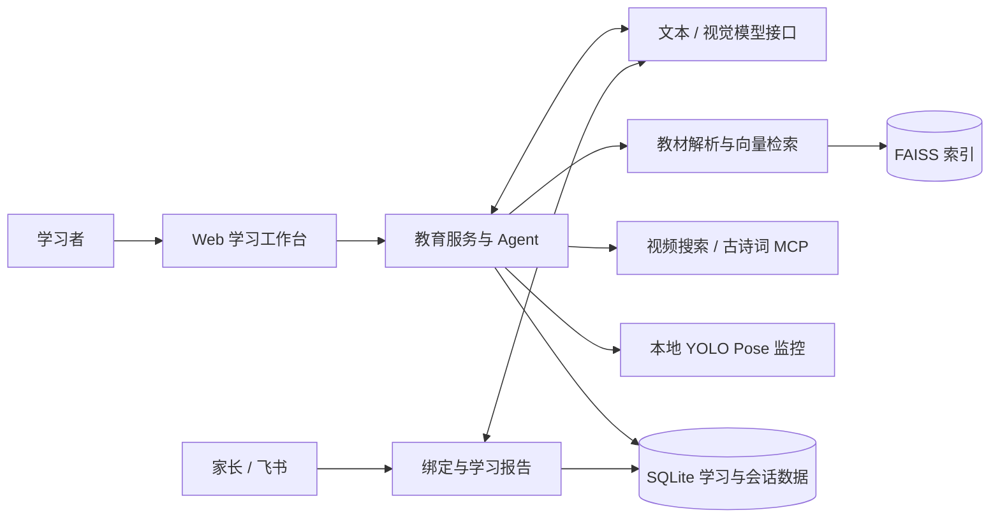

# Zhiqi · 知契智能教育助手


结合教育 Agent、教材检索和本地视觉分析的学习辅助应用。覆盖学习对话、作业批改、学习计划与自习陪学，并提供学习记录和家长报告模块。

[功能特性](#功能特性) · [系统架构](#系统架构) · [快速开始](#快速开始) · [配置指南](docs/configuration.md) · [开发指南](docs/development.md)

## 功能特性

| 模块 | 功能 |
| --- | --- |
| 学习助手 | 学习问答、多模态作业批改与学习计划 |
| 教材检索 | 文档解析、分块、Embedding 与 FAISS 相似度检索 |
| 教学工具 | B 站教学视频搜索、古诗词 MCP 服务 |
| 专注监控 | 基于 YOLO Pose 关键点分析坐姿与注意力状态 |
| 学习记录 | 用户、会话、聊天与学习数据的 SQLite 持久化 |
| 家长报告 | 账号绑定、学习摘要与报告推送模块 |
| 交互界面 | Web 学习工作台、知识库管理与飞书渠道 |

## 系统架构



教育服务基于 NanoClaw Agent 扩展。教材检索为对话提供相关片段，本地视觉模块负责关键点推理，学习与会话数据由 SQLite 保存。

## 技术栈

- **Agent 与服务**：Python、NanoClaw、FastAPI、OpenAI 兼容模型接口。
- **RAG**：文档解析、Embedding、FAISS、NumPy。
- **视觉**：Ultralytics YOLO Pose、OpenCV。
- **数据与渠道**：SQLite、bcrypt、Web、飞书与 MCP。

## 快速开始

### 1. 获取项目

```bash
git clone https://github.com/chuantiet5-stack/zhiqi-ai-education-assistant.git
cd zhiqi-ai-education-assistant/nanoclaw
```

建议使用独立 Python 虚拟环境，见[开发指南](docs/development.md)。

### 2. 安装与配置

```bash
python -m pip install -r requirements.txt
python -c "import shutil; shutil.copyfile('config.example.json', 'config.json')"
```

编辑 `config.json`，填写 `api_key`，并确认文本与视觉模型名称可由所配置的接口提供。飞书、RAG 和 MCP 设置见[配置指南](docs/configuration.md)。

### 3. 启动服务

```bash
python main.py
```

| 入口 | 地址 |
| --- | --- |
| 注册与登录 | <http://127.0.0.1:8080> |
| 学习工作台 | <http://127.0.0.1:8080/edu> |
| 教材知识库管理 | <http://127.0.0.1:8080/rag_admin> |

首次使用需创建本地账号，并在知识库管理页导入自己的教材。专注监控需要运行服务的设备连接可用摄像头。

## 项目结构

```text
.
├── nanoclaw/
│   ├── agent/
│   │   ├── rag/                   # 文档解析、向量化与检索
│   │   ├── tools/                 # 教育、视频、RAG 与视觉工具
│   │   └── edu_loop.py            # 教育 Agent 执行循环
│   ├── channels/web_ui/           # 登录、学习与知识库页面
│   ├── db/                        # SQLite 持久层
│   ├── mcp_servers/               # 古诗词工具服务
│   ├── models/                    # YOLO Pose 本地模型
│   ├── session/                   # 会话与持久记忆
│   ├── edu_service.py             # 教育业务服务
│   ├── focus_monitor.py           # 专注监控
│   ├── parent_report.py           # 家长报告
│   ├── config.example.json
│   └── main.py
└── docs/                          # 配置与开发文档
```

## 文档

- [配置与教材接入](docs/configuration.md)：模型、RAG、MCP、摄像头与飞书。
- [开发与验证](docs/development.md)：开发环境、代码入口与功能验证流程。

本地凭证、账号、教材索引、上传内容与会话数据由 `.gitignore` 排除。仓库不包含用户运行数据。
